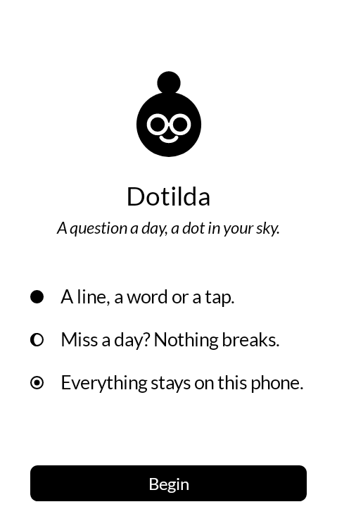
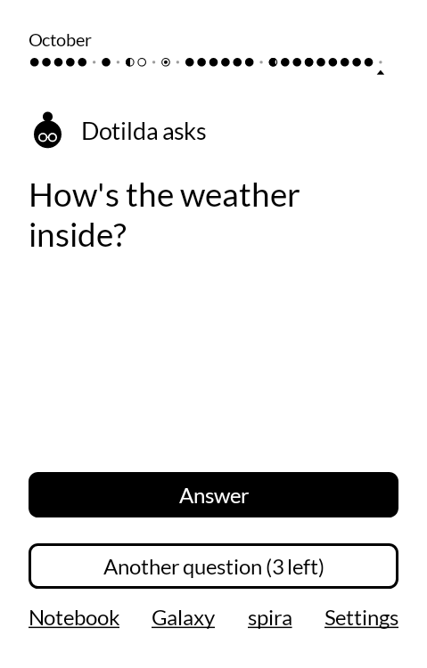
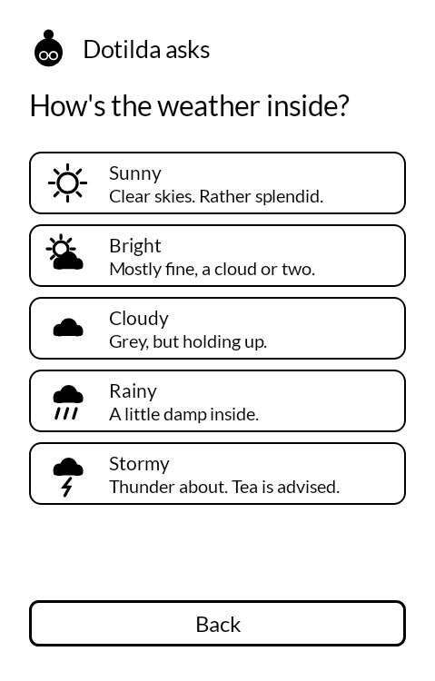
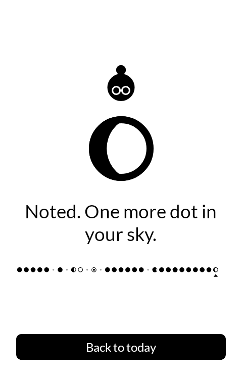
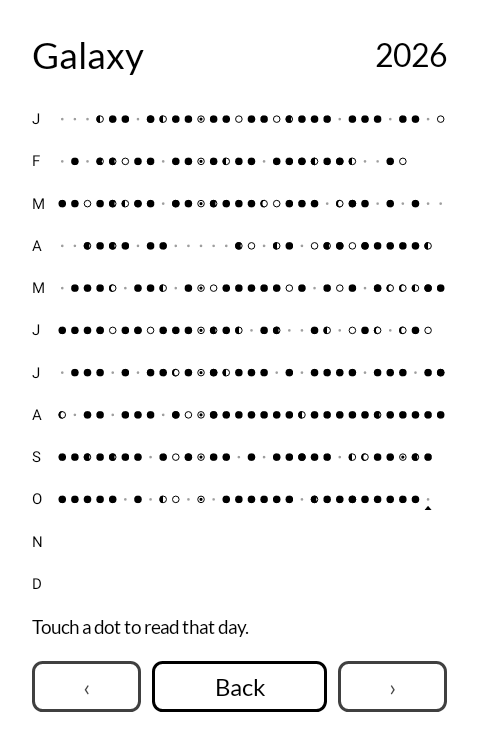
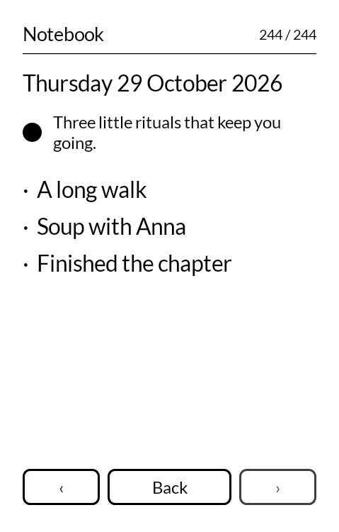
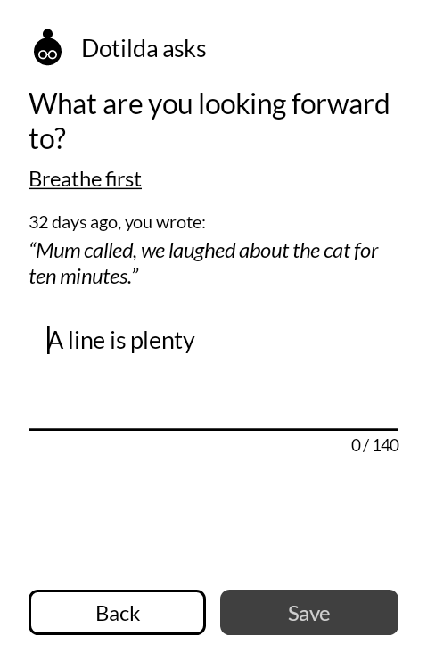
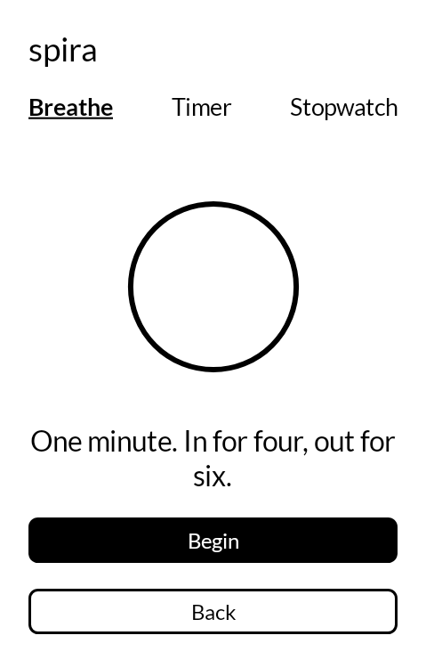

# Dotilda

**A question a day, a dot in your sky.** · [www.dotilda.com](https://www.dotilda.com)

A gentle daily journaling app for e-ink Android devices, first of all the Mudita Kompakt.
Dotilda, an ink dot with a bun and round glasses, asks you one small question a day. You answer
in a line, a word or a tap, and a dot appears in your sky: a year drawn in ink, one dot per day.
Free, private and open source. An app by readme.club, made and maintained by LesWWW.

<p>
  
  
  
  
</p>
<p>
  
  
  
  
</p>

## What it does

- **One question a day**, at the hour you choose, from a bank of more than 200. Not happy with
  it? Ask for another, up to three times; after that, just tell Dotilda the weather inside.
- **Many ways to answer**: one line, one word, this or that, three small things, the inner
  weather (sunny to stormy), and Mirror questions that come back every 30 days and show what
  you wrote last time.
- **A sky of dots**: each answer fills the day's dot, shaped by the answer (the inner weather is
  a moon phase). The Galaxy shows the whole year on one screen; the Notebook lets you reread
  your days, page by page, with the volume buttons.
- **Nothing to lose**: miss a day and nothing breaks. An empty day is a tiny grey dot. No
  streaks, no red, no guilt, and no line linking a "complete" week.
- **spira**: a breathing minute before writing, a timer that rings with the screen off, and a
  stopwatch, which the Kompakt lacks.
- **Yours, on your device**: no account, no tracking, no ads. Export the whole journal to a zip
  file and import it on another device. The only network access is the optional update check
  against this repository's releases, and it sends nothing about you.
- **Made for e-ink**: pure black on white, large type, no animation, no scrolling. Dotilda
  changes pose in a single step, like turning a page.

Coming next: journeys that draw constellations, monthly and seasonal reviews, photo of the day
(dithered in four greys), sealed letters to your future self, and the year as an EPUB book.

## Install

Download `dotilda.apk` from the [latest release](https://github.com/kxrz/dotilda-app/releases/latest)
and install it with Mudita Center or Obtainium. Dotilda then updates itself from Settings.
Requires Android 11 or later; designed for the Mudita Kompakt (MuditaOS K).

## Build

Kotlin, Jetpack Compose and [Mudita Mindful Design](https://github.com/mudita/MMD).

```bash
./gradlew assembleDebug
```

The APK lands in `app/build/outputs/apk/debug/`. Every push also builds it on GitHub Actions
(artifact `dotilda-debug-apk`), and the Screenshots workflow renders every screen at the
Kompakt's size to the branch `screenshots/<branch>`.

## Release

1. Bump `appVersion` in `app/build.gradle.kts` and add its section to `CHANGELOG.md`.
2. Push the tag `v<version>` (or run the Build workflow by hand on `main` with the version).
3. The workflow publishes `dotilda.apk` and `manifest.json` on GitHub Releases; installed apps
   find the update in Settings.

The release key is read from the repository secrets `RELEASE_KEYSTORE_BASE64`,
`RELEASE_KEYSTORE_PASSWORD`, `RELEASE_KEY_ALIAS` and `RELEASE_KEY_PASSWORD`.

## Docs

- Website: [www.dotilda.com](https://www.dotilda.com) (branch `website`)
- Product spec (French): [docs/spec.md](docs/spec.md)
- Changes: [CHANGELOG.md](CHANGELOG.md)

## License

Apache 2.0, see [LICENSE](LICENSE).
