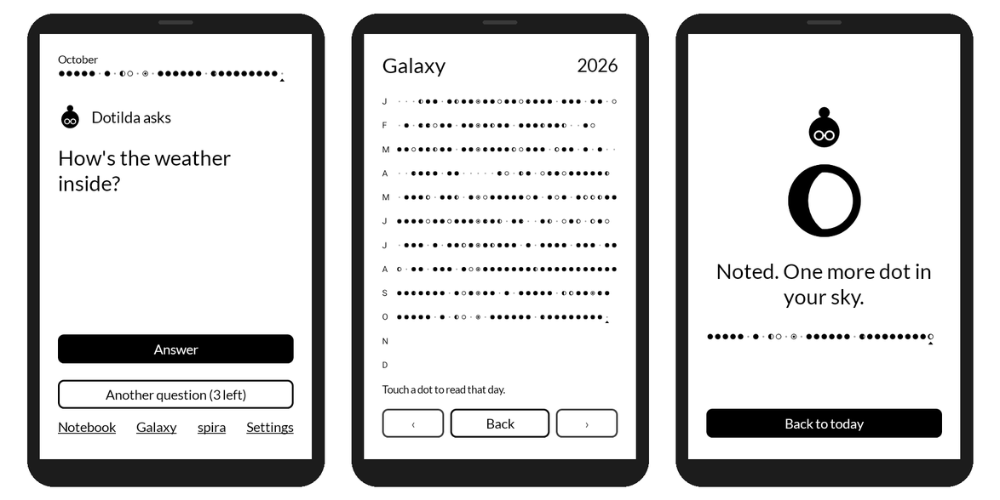

<h1 align="center">Dotilda</h1>

<p align="center">
  <b>A question a day, a dot in your sky.</b><br>
  A gentle daily journaling app for the Mudita Kompakt and Android e-readers.<br>
  <a href="https://www.dotilda.com">www.dotilda.com</a> ·
  <a href="https://github.com/kxrz/dotilda-app/releases/latest">Download</a> ·
  <a href="CHANGELOG.md">What's new</a>
</p>

<p align="center">
  <a href="https://github.com/kxrz/dotilda-app/releases/latest"></a>
  <a href="https://github.com/kxrz/dotilda-app/actions/workflows/build.yml"></a>
  <a href="LICENSE"></a>
  
</p>

<p align="center">
  
</p>

Dotilda, an ink dot with a bun and round glasses, asks you one small question a day. You answer
in a line, a word or a tap, and a dot appears in your sky: a year drawn in ink, one dot per day.
It takes less than two minutes. Free, private and open source.
An app by readme.club, made and maintained by LesWWW.

## How it works

1. **Dotilda asks.** One small question, at the hour you choose. No feed, nothing to catch up on.
2. **You answer.** A line, a word, a choice between two things, or just the weather inside.
3. **A dot appears.** Each answer adds one dot to the year. It is drawn once, in ink, and stays still.

## What it does

| | |
| --- | --- |
| **A question a day** | More than 200 questions, so you never feel you are going round in circles. Ask for another up to three times; after that, Dotilda simply asks how the weather is inside. |
| **Many ways to answer** | One line, one word, this or that, three small things, the inner weather from sunny to stormy, and Mirror questions that come back every 30 days and show what you wrote last time. |
| **A sky of dots** | Each dot takes the shape of its answer: the inner weather is a moon phase, a Mirror a dot inside a ring. The Galaxy shows the whole year on one screen; touch a dot to reread that day. |
| **A notebook** | Reread your days page by page, turning pages with the volume buttons, like on an e-reader. |
| **Nothing to lose** | Miss a day and nothing breaks: an empty day is a tiny grey dot. No streaks, no red, no guilt. |
| **spira** | A breathing minute before writing, a timer that rings with the screen off, and a stopwatch, which the Kompakt lacks. |
| **Made for e-ink** | Pure black on white, large type, no animation, no scrolling. Dotilda changes pose in a single step, like turning a page. |

**Coming next:** journeys that draw constellations, monthly and seasonal reviews, a photo of the
day dithered in four greys, sealed letters to your future self, and the year as an EPUB book.

<p align="center">
  
  
  
  
  
</p>

## Privacy

- No account, no tracking, no ads, no analytics.
- Your journal stays on your device. Export it to a zip file whenever you like (plain JSON, readable
  without the app) and import it on another device.
- The only network access is the update check against this repository's releases. It sends
  nothing about you, and it can be turned off in Settings.

## Install

Everything is explained, in English, French, Spanish, Portuguese and Polish, on
**[www.dotilda.com](https://www.dotilda.com)**, where you can also try a question before installing.

1. Download `dotilda.apk` from the [latest release](https://github.com/kxrz/dotilda-app/releases/latest).
2. Install it with Mudita Center or [Obtainium](https://github.com/ImranR98/Obtainium).
3. From then on, Dotilda tells you herself when a new version is ready, and installs it from Settings.

Requires Android 11 or later. Designed for the Mudita Kompakt (MuditaOS K, 480 × 800 e-ink),
and works on other Android e-readers.

## Development

Kotlin, Jetpack Compose, [Mudita Mindful Design](https://github.com/mudita/MMD), Room and DataStore.

```bash
./gradlew assembleDebug
```

```bash
./gradlew testDebugUnitTest --tests "com.dotilda.app.data.*" --tests "com.dotilda.app.update.*"
```

The debug build is a separate app, "Dotilda dev" (`com.dotilda.app.debug`), so it sits next to
the released one. GitHub Actions runs the tests and builds it on every push (artifact
`dotilda-debug-apk`). The Screenshots workflow renders every screen at the Kompakt's size with a
made-up year of journal and pushes the images to the branch `screenshots/<branch>`.

| Path | What lives there |
| --- | --- |
| `app/src/main/java/com/dotilda/app/data` | Room database, questions, answers, the daily question picker, export and import. |
| `app/src/main/java/com/dotilda/app/ui` | The screens, Dotilda's poses, the dots and the weather pictos. |
| `app/src/main/java/com/dotilda/app/update` | In-app updates from GitHub Releases. |
| `app/src/main/assets/questions.json` | The question bank. |
| `app/src/main/res/values/strings.xml` | Every word of the interface. |
| `app/src/test` | Unit tests and the screenshot tour. |
| `docs/spec.md` | The product spec: principles, formats, screens, constraints, milestones. |

The website, [www.dotilda.com](https://www.dotilda.com), lives on the [`website`](https://github.com/kxrz/dotilda-app/tree/website)
branch, with its own README.

### Release

1. Bump `appVersion` in `app/build.gradle.kts` and add its section to `CHANGELOG.md`.
2. Push the tag `v<version>`, or run the Build workflow by hand on `main` with the version.
3. The workflow signs the APK and publishes `dotilda.apk` and `manifest.json` on GitHub Releases,
   where installed apps find the update.

### Translations

The interface is in English for now. A language is added with
`app/src/main/res/values-<code>/strings.xml` and a translated question bank.

## Credits

Built on [Mudita Mindful Design](https://github.com/mudita/MMD) (Apache 2.0) and its Lato typeface
(SIL Open Font License).

## License

Apache 2.0, see [LICENSE](LICENSE).
